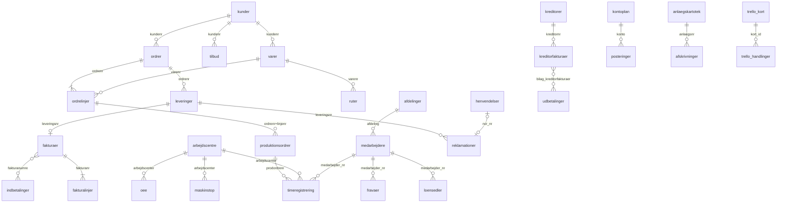

# Relationer – sådan hænger tabellerne sammen

Nøgler og joins mellem tabellerne i `clean/`. Match-procenten er målt på de leverede filer: andelen af udfyldte værdier i kolonnen, som findes i den tabel, der peges på.

## Overblik

## Primærnøgler

| Tabel | Nøgle | Rækker |
|---|---|---|
| `kunder` | `kundenr` | 71 |
| `kreditorer` | `kreditornr` | 60 |
| `varer` | `varenr` | 827 |
| `tilbud` | `tilbudsnr` | 2.139 |
| `ordrer` | `ordrenr` | 31.784 |
| `ordrelinjer` | `ordrenr` + `linjenr` | 73.128 |
| `leveringer` | `leveringsnr` | 32.695 |
| `fakturaer` | `fakturanr` | 33.111 |
| `fakturalinjer` | `fakturanr` + `linjenr` | 113.682 |
| `debitorer_primo` | `fakturanr` | 690 |
| `kreditorfakturaer` | `bilagsnr` | 4.266 |
| `kreditorer_primo` | `bilagsnr` | 78 |
| `kontoplan` | `konto` | 84 |
| `anlaegskartotek` | `anlaegsnr` | 58 |
| `afskrivninger` | `anlaegsnr` + `maaned` | 2.190 |
| `markedsindeks` | `maaned` | 60 |
| `arbejdscentre` | `arbejdscenter` | 29 |
| `ruter` | `varenr` + `operation_nr` | 3.013 |
| `produktionsordrer` | `prodordrenr` | 73.455 |
| `timeregistrering` | `registreringsnr` | 457.831 |
| `maskinstop` | `stopnr` | 8.326 |
| `oee` | `arbejdscenter` + `maaned` | 593 |
| `reklamationer` | `ncr_nr` | 920 |
| `henvendelser` | `henvendelsesnr` | 6.778 |
| `medarbejdere` | `medarbejder_nr` | 143 |
| `afdelinger` | `afdeling` | 10 |
| `trello_kort` | `kort_id` | 360 |
| `mails` | `message_id` | 4.194 |
| `arbejdskalender` | `dato` | 1.826 |
| `noegletal` | `aar` | 5 |
| `kpi_maaned` | `maaned` | 30 |

Tabeller uden en entydig nøgle: `posteringer`, `bankkontoudtog`, `indbetalinger`, `udbetalinger` (én række pr. bevægelse; `bilagsnr` samler posteringerne på ét bilag), `loensedler`, `fravaer`, `stillingshistorik` (én række pr. medarbejder og periode) og de lange regnskabstabeller `resultatopgoerelse`/`balance` (`post` + `aar`).

## Fremmednøgler

| Fra | Til | Match | Bemærkning |
|---|---|---|---|
| `varer.kundenr` | `kunder.kundenr` | 100% af 819 | Kundespecifikke emner; tom for ydelser |
| `tilbud.kundenr` | `kunder.kundenr` | 100% af 2.139 |  |
| `tilbud.varenr` | `varer.varenr` | 100% af 537 | Kun når tilbuddet gjaldt et eksisterende emne |
| `ordrer.kundenr` | `kunder.kundenr` | 100% af 31.784 |  |
| `ordrelinjer.ordrenr` | `ordrer.ordrenr` | 100% af 73.128 |  |
| `ordrelinjer.varenr` | `varer.varenr` | 100% af 73.128 |  |
| `leveringer.ordrenr` | `ordrer.ordrenr` | 100% af 32.695 |  |
| `leveringer.kundenr` | `kunder.kundenr` | 100% af 32.695 |  |
| `fakturaer.ordrenr` | `ordrer.ordrenr` | 100% af 33.051 |  |
| `fakturaer.leveringsnr` | `leveringer.leveringsnr` | 100% af 33.051 | Én faktura pr. levering |
| `fakturaer.kundenr` | `kunder.kundenr` | 100% af 33.111 |  |
| `fakturaer.krediterer_fakturanr` | `fakturaer.fakturanr` | 100% af 368 | Kreditnota → den faktura, den krediterer |
| `fakturalinjer.fakturanr` | `fakturaer.fakturanr` | 100% af 113.682 |  |
| `fakturalinjer.varenr` | `varer.varenr` | 100% af 113.682 |  |
| `fakturalinjer.ordrenr` + `fakturalinjer.ordrelinjenr` | `ordrelinjer.ordrenr` + `ordrelinjer.linjenr` | 100% af 72.022 |  |
| `indbetalinger.kundenr` | `kunder.kundenr` | 100% af 8.093 |  |
| `indbetalinger.fakturanumre` | `fakturaer.fakturanr` eller `debitorer_primo.fakturanr` | 100% af 32.983 | `;`-separeret liste; ældre fakturaer findes i debitorer_primo |
| `debitorer_primo.kundenr` | `kunder.kundenr` | 100% af 690 |  |
| `kreditorfakturaer.kreditornr` | `kreditorer.kreditornr` | 100% af 4.266 |  |
| `udbetalinger.kreditornr` | `kreditorer.kreditornr` | 100% af 2.577 |  |
| `udbetalinger.bilag_kreditorfakturaer` | `kreditorfakturaer.bilagsnr` eller `kreditorer_primo.bilagsnr` | 100% af 4.251 | `;`-separeret liste; ældre bilag findes i kreditorer_primo |
| `kreditorer_primo.kreditornr` | `kreditorer.kreditornr` | 100% af 78 |  |
| `posteringer.konto` | `kontoplan.konto` | 100% af 171.811 | Navi-nummeret står også i `konto_navi` |
| `posteringer.dato` | `arbejdskalender.dato` | 100% af 171.811 |  |
| `afskrivninger.anlaegsnr` | `anlaegskartotek.anlaegsnr` | 100% af 2.190 |  |
| `arbejdscentre.afdeling` | `afdelinger.afdeling` | 100% af 29 |  |
| `ruter.varenr` | `varer.varenr` | 100% af 3.013 |  |
| `ruter.arbejdscenter` | `arbejdscentre.arbejdscenter` | 100% af 3.013 |  |
| `produktionsordrer.ordrenr` | `ordrer.ordrenr` | 100% af 73.455 |  |
| `produktionsordrer.ordrenr` + `produktionsordrer.linjenr` | `ordrelinjer.ordrenr` + `ordrelinjer.linjenr` | 100% af 73.455 | Én produktionsordre pr. ordrelinje (+ omarbejde) |
| `produktionsordrer.varenr` | `varer.varenr` | 100% af 73.455 |  |
| `timeregistrering.medarbejder_nr` | `medarbejdere.medarbejder_nr` | 100% af 457.831 |  |
| `timeregistrering.prodordrenr` | `produktionsordrer.prodordrenr` | 100% af 396.075 | Tom for indirekte timer |
| `timeregistrering.arbejdscenter` | `arbejdscentre.arbejdscenter` | 100% af 396.075 |  |
| `timeregistrering.dato` | `arbejdskalender.dato` | 100% af 457.831 |  |
| `maskinstop.arbejdscenter` | `arbejdscentre.arbejdscenter` | 100% af 8.326 |  |
| `oee.arbejdscenter` | `arbejdscentre.arbejdscenter` | 100% af 593 |  |
| `reklamationer.kundenr` | `kunder.kundenr` | 100% af 726 | Tom for interne afvigelser |
| `reklamationer.kreditornr` | `kreditorer.kreditornr` | 100% af 21 | Kun leverandørreklamationer |
| `reklamationer.ordrenr` | `ordrer.ordrenr` | 100% af 899 |  |
| `reklamationer.leveringsnr` | `leveringer.leveringsnr` | 100% af 726 |  |
| `reklamationer.prodordrenr` | `produktionsordrer.prodordrenr` | 100% af 899 |  |
| `reklamationer.varenr` | `varer.varenr` | 100% af 899 |  |
| `reklamationer.kreditnota_fakturanr` | `fakturaer.fakturanr` | 100% af 238 |  |
| `reklamationer.omarbejde_prodordrenr` | `produktionsordrer.prodordrenr` | 100% af 327 |  |
| `henvendelser.kundenr` | `kunder.kundenr` | 100% af 6.778 |  |
| `henvendelser.ordrenr` | `ordrer.ordrenr` | 100% af 6.778 |  |
| `henvendelser.ncr_nr` | `reklamationer.ncr_nr` | 100% af 726 | Når henvendelsen blev til en reklamation |
| `medarbejdere.afdeling` | `afdelinger.afdeling` | 100% af 143 |  |
| `medarbejdere.naermeste_leder_nr` | `medarbejdere.medarbejder_nr` | 100% af 142 |  |
| `stillingshistorik.medarbejder_nr` | `medarbejdere.medarbejder_nr` | 100% af 148 |  |
| `loensedler.medarbejder_nr` | `medarbejdere.medarbejder_nr` | 100% af 8.837 |  |
| `fravaer.medarbejder_nr` | `medarbejdere.medarbejder_nr` | 100% af 5.758 |  |
| `trello_handlinger.kort_id` | `trello_kort.kort_id` | 100% af 984 |  |
| `mails.kundenr` | `kunder.kundenr` | 100% af 2.888 |  |
| `mails.kreditornr` | `kreditorer.kreditornr` | 100% af 798 |  |
| `mails.ordrenr` | `ordrer.ordrenr` | 100% af 2.025 |  |
| `mails.tilbudsnr` | `tilbud.tilbudsnr` | 100% af 854 |  |
| `mails.ncr_nr` | `reklamationer.ncr_nr` | 100% af 1.034 |  |
| `mails.henvendelsesnr` | `henvendelser.henvendelsesnr` | 100% af 2.025 |  |
| `mails.arbejdscenter` | `arbejdscentre.arbejdscenter` | 100% af 336 |  |

## Brugere

Medarbejdere optræder på to måder: `medarbejder_nr` (HR, løn, timer) og `brugerid` – initialerne, de logger ind i systemerne med. Kolonnerne herunder indeholder `brugerid` og joines til `medarbejdere.brugerid`. `MIGRERING` er ikke en person, men systembrugeren fra dataoverførslen.

| Kolonne | Match |
|---|---|
| `tilbud.saelger` | 100% |
| `ordrer.saelger` | 100% |
| `kreditorfakturaer.bogfoert_af` | 100% |
| `kreditorfakturaer.godkendt_af` | 100% |
| `kreditorer.oprettet_af` | 100% |
| `maskinstop.registreret_af` | 100% |
| `reklamationer.oprettet_af` | 100% |
| `henvendelser.behandlet_af` | 100% |
| `trello_handlinger.bruger` | 100% |
| `trello_kort.medlemmer` | 100% |

## Faldgruber

- **Læs nøgler som tekst** (`dtype=str`). `ordrenr` og `fakturanr` er heltal i e-conomic og `ORD-ÅÅ-NNNNN`/`FAK-ÅÅ-NNNNN` i Navi ERP (fra 1. marts 2024) – begge formater står i samme kolonne. Det samme gælder bankoplysninger (`bank_regnr`, `bank_kontonr`, `iban`).
- **Listekolonner:** `indbetalinger.fakturanumre`, `udbetalinger.bilag_kreditorfakturaer`, `mails.til`/`cc`/`vedhaeftninger` er `;`-separerede; `trello_kort.medlemmer` og `labels` er `,`-separerede. Brug fx `str.split(";").explode()` før join.
- **Primo-tabellerne** (`debitorer_primo`, `kreditorer_primo`) er de åbne poster pr. 1. januar 2021. Betalinger i starten af 2021 peger på dem og ikke på `fakturaer`/`kreditorfakturaer`.
- **Kontonumre:** `posteringer.konto` er e-conomic-nummeret gennem hele perioden; `kontoplan` oversætter til Navi-nummer og årsrapportlinje.
- **Måned:** `maaned` er `ÅÅÅÅ-MM` overalt undtagen `arbejdskalender.maaned` (1–12). Brug `arbejdskalender.dato` til dagstabeller.
- **Fortegn:** I `posteringer` er debet positiv og kredit negativ – omsætning er derfor negativ.
- **Årsafslutning:** Hvert år d. 31/12 nulstiller posteringer med `kilde = "Årsafslutning"` alle driftskonti mod egenkapitalen. Filtrér dem fra, når du summerer resultatopgørelsen fra `posteringer` – ellers bliver omsætningen 0.
- **Mails:** én række pr. mail; `traad_id` samler en tråd, `fil` peger på .eml-filen i `08_mail/`. Referencekolonnerne (`kundenr`, `ordrenr`, `ncr_nr` …) er kun udfyldt, når tråden handler om noget bestemt.
